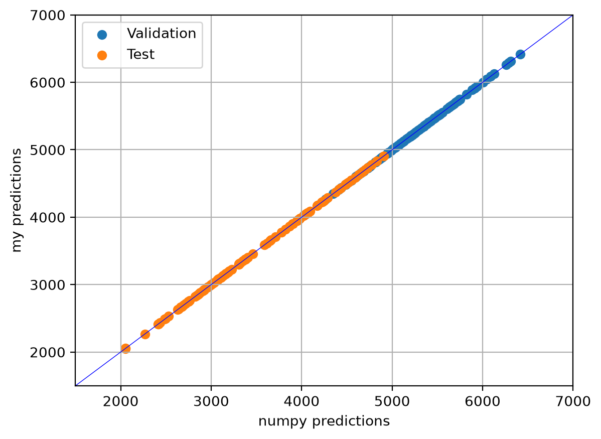
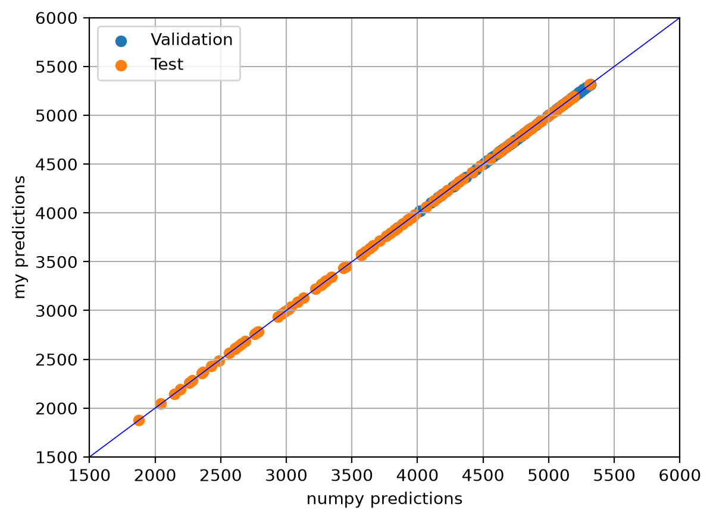

# Bike Sharing Regression

Multiple linear and quadratic polynomial regression models that predict daily bike rentals (`cnt`) from temperature and humidity in the [UCI Bike Sharing Dataset](https://archive.ics.uci.edu/dataset/275/bike+sharing+dataset).

Both models are implemented using handwritten matrix operations and Gaussian elimination. Their coefficients and predictions are compared against NumPy’s least-squares solver.

## Run

Install the dependencies and run both scripts from the project root:

```sh
pip install numpy pandas matplotlib
python src/MultipleRegression.py
python src/PolynomialRegression.py
```

Both scripts print coefficients, evaluation metrics, and differences from NumPy’s predictions. They also display comparison plots and save them in the `images` directory.

## Inputs and methods

The local `daily.csv` has no header. After dropping columns `[0, 1]`, temperature is `days.iloc[:, 8]`, humidity is `days.iloc[:, 10]`, and total rentals are the last column.

Temperature and humidity are already normalized. The prediction functions accept these normalized values, without further scaling.

Multiple linear regression uses:

```python
[1, temperature, humidity]
```

Quadratic polynomial regression uses:

```python
[1, temperature, humidity,
 temperature**2, temperature*humidity, humidity**2]
```

Both models solve the normal equations:

$$
(X^\mathsf{T}X)\beta=X^\mathsf{T}y.
$$

Shared functions are stored in `src/math_operations.py`. Matrix multiplication, transposition, and Gaussian elimination with partial pivoting are implemented from scratch.

The solver rejects zero or near-zero pivots using a tolerance scaled to the original coefficient matrix. Normal equations can amplify numerical conditioning problems; this check does not guarantee numerical stability.

## Prediction accuracy

The 731 observations are split chronologically, without shuffling:

| Portion | Observations | Dates |
| --- | ---: | --- |
| Training | 511 | 2011-01-01 to 2012-05-25 |
| Validation | 110 | 2012-05-26 to 2012-09-12 |
| Test | 110 | 2012-09-13 to 2012-12-31 |

Only training observations determine the coefficients. Both models are evaluated on validation and test data without refitting. The baseline predicts the training-set mean of 3794.21 rentals for every observation.

MAE and RMSE measure prediction error in rentals; lower values are better. R² compares squared prediction error against predicting the evaluated portion’s own mean; higher values are better.

Recorded results for the included dataset:

| Portion | Model | MAE | RMSE | R² |
| --- | --- | ---: | ---: | ---: |
| Validation | Multiple regression | 1613.48 | 1810.24 | -3.4951 |
| Validation | Polynomial regression | 1945.54 | 2047.60 | -4.7512 |
| Validation | Training-mean baseline | 2961.04 | 3081.68 | -12.0270 |
| Test | Multiple regression | 2346.18 | 2550.84 | -0.6261 |
| Test | Polynomial regression | 1990.00 | 2179.40 | -0.1870 |
| Test | Training-mean baseline | 2352.94 | 2663.19 | -0.7725 |

Multiple regression performs better on validation, while polynomial regression performs better on test. Both outperform the training-mean baseline, but their negative R² values indicate substantial remaining prediction error.

## Comparison with NumPy

Each model is also fitted using `numpy.linalg.lstsq`, with exactly the same training matrix and targets.

The scripts compare:

- Fitted coefficients.
- Predictions on validation and test observations.
- MAE, RMSE, and R² against actual rental counts.
- The largest absolute prediction difference between implementations.

Coefficient and prediction comparisons use `np.testing.assert_allclose` with relative tolerance `1e-6` and absolute tolerance `1e-8`. A failed comparison raises an error.

### Multiple linear regression



### Polynomial regression



In both plots, the horizontal axis shows NumPy’s predictions and the vertical axis shows the handwritten implementation’s predictions. Colours distinguish validation and test observations. Points on the diagonal indicate agreement.

These plots check agreement between implementations, not accuracy against actual rental counts. Passing the comparisons supports correctness on the tested data; it does not prove correctness for every possible input.